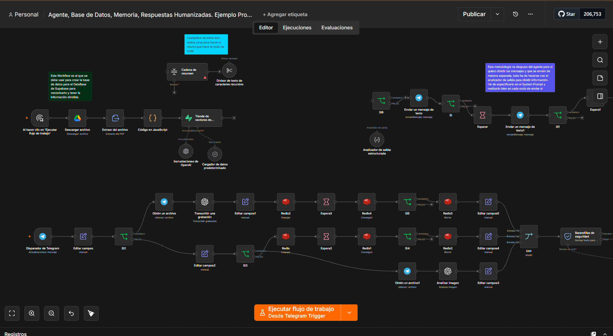
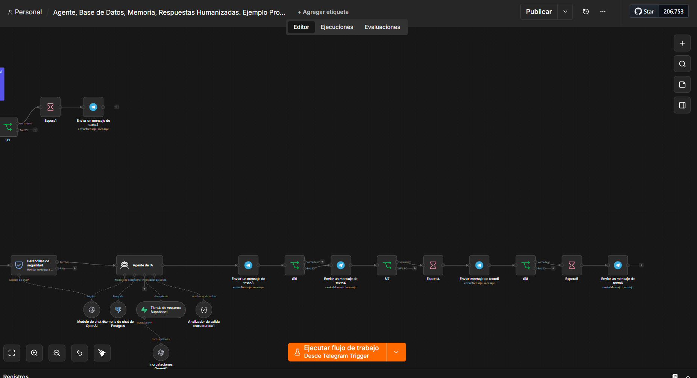

# Agente RAG multimodal con memoria (Telegram)

Asistente que responde dudas sobre el **Código Civil español** usando únicamente una base de conocimiento vectorial, sin inventar. Acepta **texto, notas de voz e imágenes**, y responde en varios mensajes cortos para que la conversación resulte natural.

## Qué problema resuelve

Un chatbot genérico "alucina" cuando no sabe algo. En temas legales eso es inaceptable. Este agente está obligado a consultar la base de conocimiento antes de responder, cita el artículo correspondiente y, si no encuentra la información, lo dice.

## Cómo funciona

1. **Ingesta (una sola vez):** descarga el PDF del Código Civil desde Google Drive, extrae el texto, lo trocea en fragmentos de 500 palabras con 50 de solapamiento, genera embeddings y los guarda en Supabase (pgvector).
2. **Entrada multimodal:** detecta si el mensaje es texto, nota de voz (transcrita con Whisper) o imagen (analizada con visión).
3. **Buffer en Redis:** si el usuario envía varios mensajes seguidos, se acumulan durante 15 s y se procesan juntos, en lugar de responder a cada uno por separado.
4. **Guardarraíles:** un modelo clasifica el mensaje y bloquea intentos de prompt injection, extracción del prompt o contenido inapropiado.
5. **Agente RAG:** consulta obligatoriamente Supabase como herramienta, mantiene memoria de la conversación en Postgres y devuelve un JSON con 3 partes.
6. **Respuesta humanizada:** cada parte se envía como un mensaje distinto con una pausa entre ellos.

## Stack

n8n · OpenAI (gpt-5-mini, Whisper, GPT-4o visión, text-embedding-ada-002) · Supabase pgvector · PostgreSQL · Redis · Telegram

## Puesta en marcha

- Tabla `documents` en Supabase con columna `embedding vector(1536)` y la función `match_documents`.
- Credenciales: OpenAI, Telegram, Supabase, Postgres, Redis y Google Drive.
- Sustituye `TU_ID_DEL_PDF_EN_DRIVE` en el nodo de descarga y ejecuta la ingesta manualmente una vez.
