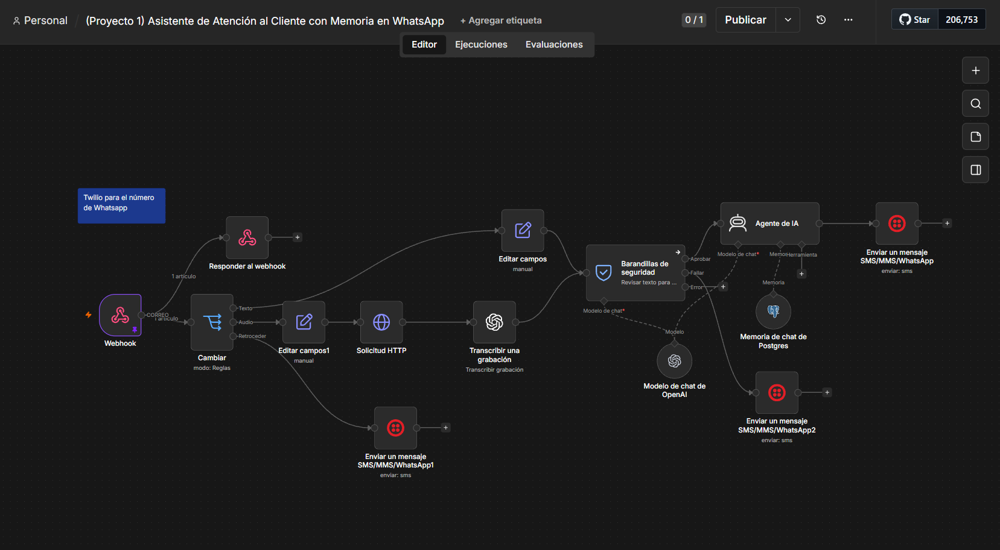

# Atención al cliente por WhatsApp con memoria

Asistente de WhatsApp para un restaurante (ficticio) de comida canaria: informa de la carta, precios, alérgenos y horarios, y deriva las reservas al teléfono. Entiende texto y notas de voz, y recuerda la conversación con cada cliente.

## Qué problema resuelve

Un restaurante recibe las mismas preguntas por WhatsApp a todas horas, muchas fuera de horario. El asistente las responde al momento sin inventar datos y con un tono cercano.

## Cómo funciona

1. **Twilio → Webhook:** cada mensaje de WhatsApp llega a n8n, que responde a Twilio de inmediato.
2. **Enrutado por tipo:** texto, nota de voz (descargada y transcrita con Whisper) o formato no soportado (respuesta de cortesía).
3. **Guardarraíles:** clasificador anti-jailbreak afinado para *no* bloquear a clientes legítimos, aunque estén enfadados o pregunten algo que no sabemos.
4. **Agente:** prompt con la carta, alérgenos y reglas de seguridad; memoria por cliente en Postgres (clave = número de WhatsApp).
5. **Respuesta** por WhatsApp vía Twilio.

## Decisiones de diseño

- El agente **no puede hacer reservas** y lo sabe: deriva al teléfono en lugar de prometer algo que no puede cumplir.
- Aviso obligatorio de trazas cuando se pregunta por alérgenos.
- El guardarraíl prioriza no bloquear a clientes reales: el agente ya tiene sus propias defensas.

## Stack

n8n · Twilio (WhatsApp) · OpenAI (gpt-4o-mini, Whisper) · PostgreSQL

## Puesta en marcha

Credenciales de Twilio, OpenAI y Postgres. Sustituye `TU_NUMERO_TWILIO` por tu número remitente y configura la URL del webhook en Twilio.
