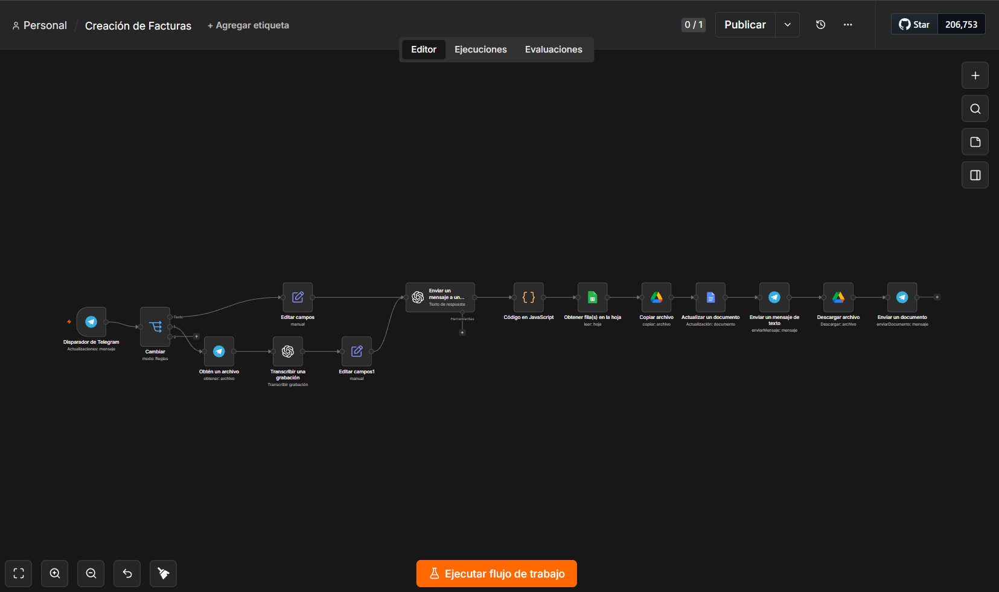

# Facturas por voz o texto (Telegram)

Envías un audio o un mensaje a un bot de Telegram —*"Factura 23 para Acme, 2 automatizaciones a 300 euros"*— y recibes la factura en PDF, rellenada con los datos del cliente.

## Qué problema resuelve

Hacer una factura a mano supone abrir la plantilla, buscar los datos del cliente, calcular impuestos y exportar. Aquí basta con dictarla desde el móvil.

## Cómo funciona

1. **Entrada:** texto o nota de voz (transcrita con Whisper).
2. **Extracción con IA:** el modelo devuelve un JSON con cliente, nº de factura, fecha, servicio, cantidad, precio, impuesto y total.
3. **Datos del cliente:** busca CIF, dirección y email en una hoja de Google Sheets.
4. **Documento:** copia una plantilla de Google Docs y sustituye los marcadores (`{{factura}}`, `{{cif_cliente}}`...).
5. **Entrega:** exporta a PDF y lo envía por Telegram.

El tipo impositivo es configurable en el nodo *Configuración*: `0.07` para IGIC (Canarias) o `0.21` para IVA.

## Stack

n8n · OpenAI (gpt-4.1-mini, Whisper) · Google Sheets · Google Docs · Google Drive · Telegram

## Puesta en marcha

- Hoja de clientes con columnas `Nombre`, `CIF`, `Dirección`, `Población`, `País`, `ZIP`, `Email`.
- Plantilla de Google Docs con los marcadores entre llaves dobles.
- Sustituye `TU_ID_HOJA_CLIENTES` y `TU_ID_PLANTILLA_FACTURA`.
